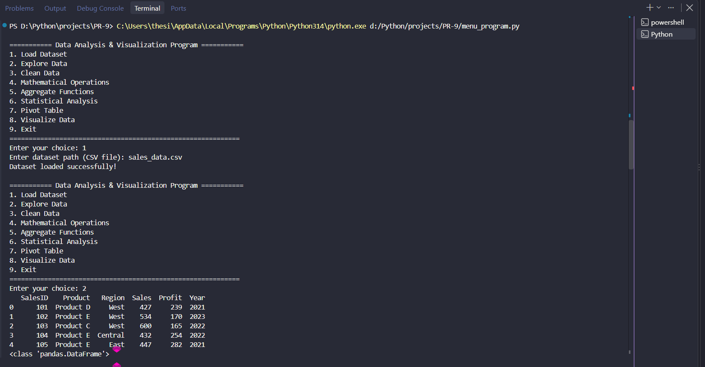
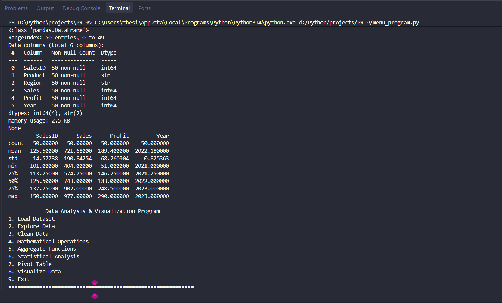
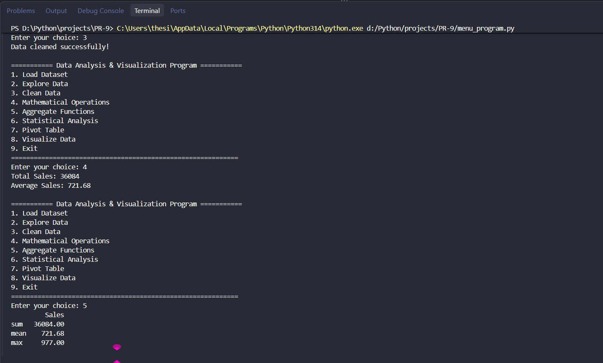
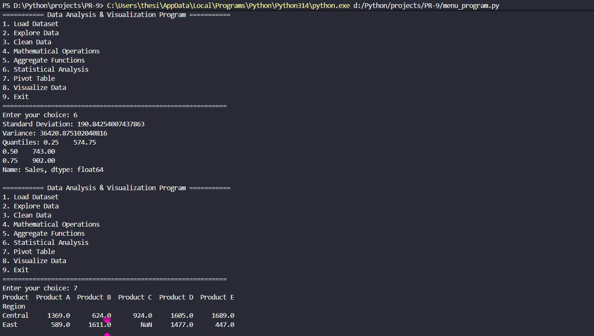
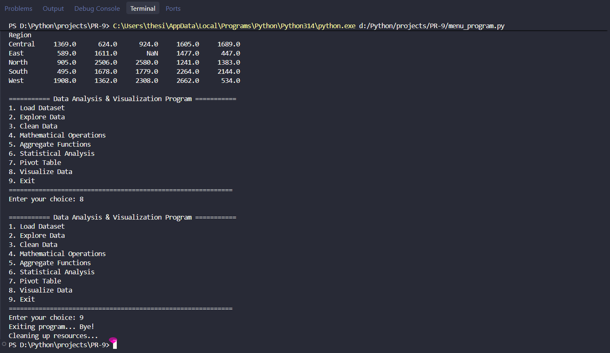
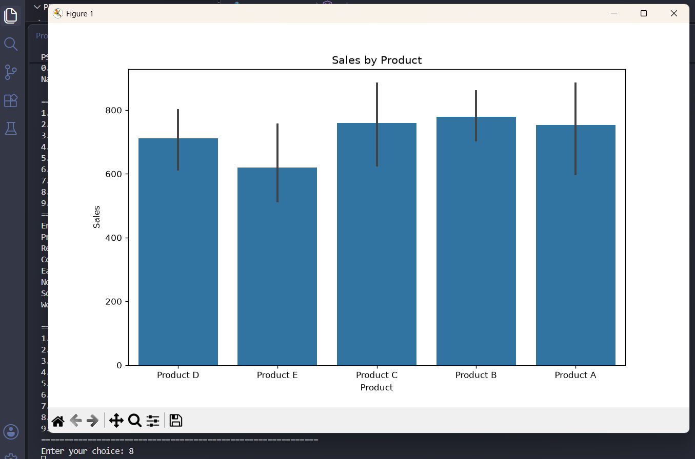
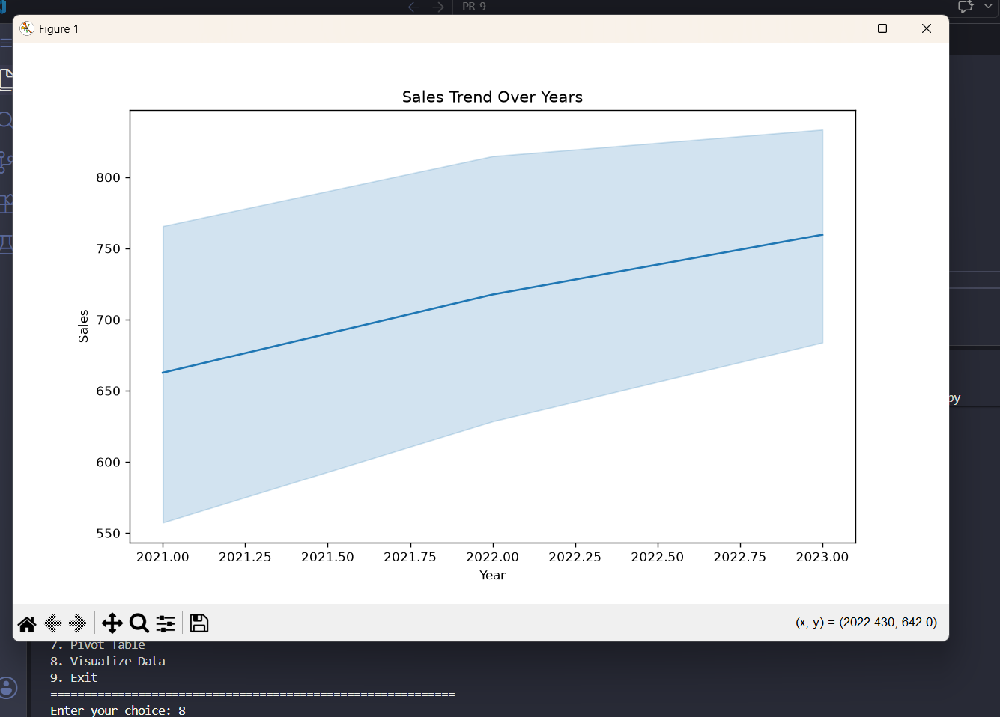
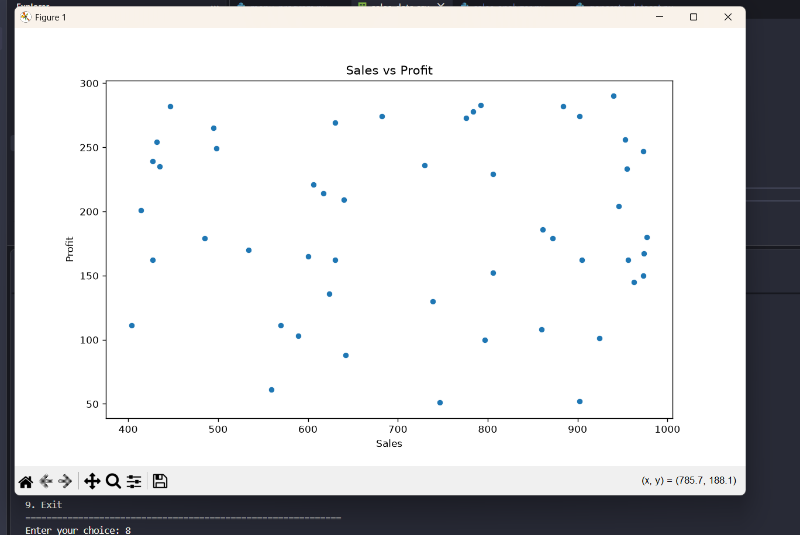

# PR-9: Data Analysis & Visualization

## 📌 Project Overview

The Data Analysis & Visualization project is a Python-based application that helps users generate, explore, clean, analyze, and visualize sales data. It uses Pandas, NumPy, Matplotlib, and Seaborn to perform various data analysis operations through a menu-driven program.

## 🎯 Objectives

- Generate sample sales data.
- Load and explore CSV datasets.
- Clean missing data.
- Perform mathematical operations.
- Apply aggregate functions.
- Perform statistical analysis.
- Create pivot tables.
- Visualize sales data using graphs.

## 🛠️ Technologies Used

- Python
- Pandas
- NumPy
- Matplotlib
- Seaborn
- CSV

## 📂 Project Structure

```text
PR-9/
│
├── generate_dataset.py
├── menu_program.py
├── sales_analyzer.py
├── sales_data.csv
├── Readme.md
└── screenshort/
    ├── SS-1.png.png
    ├── SS-2.png.png
    ├── SS-3.png.png
    ├── SS-4.png.png
    └── SS-5.png.png
```

## ✨ Features

### 1. Generate Dataset
- Generates 50 sample sales records.
- Creates data for different products, regions, and years.
- Saves the data in a CSV file.

### 2. Load Dataset
- Loads sales data from a CSV file.
- Displays a success message after loading.

### 3. Explore Data
- Displays the first five records.
- Shows dataset information.
- Displays descriptive statistics.

### 4. Clean Data
- Fills missing numerical values using column means.
- Removes rows containing remaining missing values.

### 5. Mathematical Operations
- Calculates total sales.
- Calculates average sales.

### 6. Combine and Split Data
- Combines DataFrames using Pandas.
- Splits data into groups based on a selected column.

### 7. Search, Sort, and Filter
- Filters records where sales are greater than 600.
- Sorts data by profit in descending order.

### 8. Aggregate Functions
- Calculates the sum, mean, and maximum sales.

### 9. Statistical Analysis
- Calculates standard deviation.
- Calculates variance.
- Calculates quantiles.

### 10. Pivot Table
- Creates a pivot table showing sales by region and product.

### 11. Data Visualization
- **Bar Plot:** Displays sales by product.
- **Line Plot:** Shows sales trends over the years.
- **Scatter Plot:** Shows the relationship between sales and profit.

## 📊 Dataset Information

The dataset contains the following columns:

| Column | Description |
|---|---|
| SalesID | Unique ID for each sales record |
| Product | Product name |
| Region | Sales region |
| Sales | Sales amount |
| Profit | Profit amount |
| Year | Sales year |

## ⚙️ Installation

Install the required Python libraries using:

```bash
pip install pandas numpy matplotlib seaborn
```

## ▶️ How to Run

**Step 1:** Open the project folder in VS Code.

**Step 2:** Generate the dataset.

```bash
python generate_dataset.py
```

**Step 3:** Run the menu-driven program.

```bash
python menu_program.py
```

**Step 4:** Select an option from the menu.

**Step 5:** Load `sales_data.csv` before performing analysis operations.

## 📸 Output Screenshots

### 1. Main Menu


### 2. Dataset Generation


### 3. Explore Data


### 4. Data Cleaning


### 5. Mathematical Operations


### 6. Aggregate Functions


### 7. Statistical Analysis


### 8. Pivot Table and Data Visualization

    

## 📚 Learning Outcomes

Through this project, I learned:

- Data manipulation using Pandas.
- Numerical operations using NumPy.
- Reading and writing CSV files.
- Handling missing data.
- Performing statistical calculations.
- Creating pivot tables.
- Sorting, filtering, and grouping data.
- Visualizing data using Matplotlib and Seaborn.
- Developing a menu-driven Python application.


